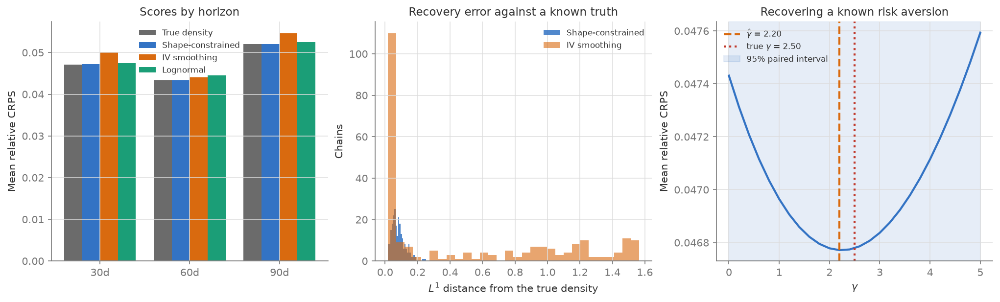

# SPX Option-Implied Probability Distributions

**What probability distribution for the future S&P 500 is embedded in SPX option prices, how well does it describe what actually happened, and does a simple pricing-kernel model close the gap?**

Fourteen years of daily SPX option chains at maturities near 30, 60 and 90 days.
Forwards and discount factors come from put–call parity.
Densities come from the Breeden–Litzenberger relation applied to a shape-constrained (Fengler-style) call-price spline.
Forecasts are scored with the continuous ranked probability score (CRPS) against realised Cboe SET settlement values.
Finally, the risk-neutral densities are tilted toward physical ones under a CRRA pricing kernel.

> **Status.** The analysis was reworked in 2026 and reviewed in November 2026; see [`docs/review-2026-11.md`](docs/review-2026-11.md) for what changed and what is still open.
> The earlier version, whose headline result did not hold up, is archived on the `archive/main-2026-11-14` branch.

## Results

From the last full run of `notebooks/02_project.ipynb` on the licensed data: 6,794 chains, which resolve against only **170 distinct expirations**.

|                              | Mean relative CRPS | Skill vs. lognormal benchmark |
| ---------------------------- | ------------------ | ----------------------------- |
| Shape-constrained            | 0.03278            | 4.8%                          |
| IV smoothing                 | 0.03313            | 3.8%                          |
| IV smoothing, recentred on F | 0.03320            | 3.5%                          |
| Lognormal at ATM implied vol | 0.03442            | —                             |

How to read it:

- Both option-implied densities beat a lognormal at the at-the-money volatility, which has no skew; the smile carries real information.
- The shape-constrained fit beats the implied-volatility baseline by about 1% of the score.
  The block bootstrap over expirations puts the difference at 0.00036 with a 95% interval of [0.00023, 0.00048], so it is small but not noise.
- The CRRA tilt is not identified: the best risk aversion is about 1.6, but the 95% interval covers the whole grid from 0 to 5.
  The synthetic demo shows the same thing with a known true value, so this is a property of CRPS as an estimator rather than of the data.

The conclusion cell of the notebook renders these numbers from the results it has just computed.

## Run it without any data

The raw vendor chains are licensed and not redistributed here.
A synthetic generator stands in for them: chains priced in closed form from a lognormal mixture, with SPX-like strike ladders, bid–ask spreads, tick rounding and stale quotes, and outcomes drawn from a CRRA tilt of the true density at a **known** gamma.

```bash
uv sync
uv run pytest
uv run python -m implied_stock_distributions.demo
```

The demo takes about half a minute.
It runs the whole pipeline on synthetic chains, prints the scores, the inference and the recovered gamma against the true one, and writes `figures/synthetic_demo.png`:



Because the truth is known there, the demo can measure what the real data cannot.
The shape-constrained fit's mean CRPS is indistinguishable from the true density's.
Its median L¹ distance from the true density is 0.07 against 0.11 for the implied-volatility baseline, and the baseline's occasional badly behaved fits push its mean distance to six times the constrained fit's.

To write a synthetic dataset that the analysis notebook loads unchanged:

```bash
uv run python -m implied_stock_distributions.synthetic
uv run jupyter lab notebooks/02_project.ipynb
```

The numbers it produces describe the synthetic market, not SPX.

## Running on the real data

You need daily SPX option-chain CSVs at `data/raw/SPX/<year>/*.csv`, with columns `OptionKey`, `Symbol`, `DataDate`, `ExpirationDate`, `PutCall`, `StrikePrice`, `BidPrice`, `AskPrice`, `BidSize`, `AskSize`, `LastPrice`, `Volume`, `OpenInterest` and `UnderlyingPrice`.
Run `notebooks/01_processing.ipynb` (raw CSVs to monthly Parquet, plus the Cboe settlement values), then `notebooks/02_project.ipynb` (the analysis).
The external validation series (FRED short rates, Shiller dividends, Cboe SKEW and VIX) are downloaded on first use and cached under `data/external/`.

## Layout

```
implied_stock_distributions/
    config.py        paths, sample definition, every hyperparameter
    pricing.py       Black's formula on a forward, and its inversion
    forwards.py      forward and discount factor from put-call parity
    fitting.py       the shape-constrained call-price spline
    smoothing.py     the unconstrained implied-volatility baseline
    selection.py     cross-validated choice of the roughness penalty
    evaluation.py    CRPS, PIT, and the risk-neutral to physical tilt
    pipeline.py      one chain end to end: both fits, a benchmark, the scores
    benchmarks.py    reference forecasts to score against
    stats.py         Diebold-Mariano, block bootstrap, calibration tests
    validation.py    outputs checked against published external series
    synthetic.py     synthetic chains with a known true density
    demo.py          the whole pipeline on synthetic data
    data_access.py   locating, cataloguing and loading processed chains
    plotting.py      the figures used in the notebook
notebooks/
    01_processing.ipynb   raw CSVs to monthly Parquet, plus settlement values
    02_project.ipynb      the analysis and the write-up
tests/                    pytest suite, checked against exact answers
docs/
    review-2026-11.md     the November 2026 review
```

## What is worth looking at

**The fit is a probability distribution by construction, and says so.**
The boundary conditions `g(0) = 1`, `g'(0) = -1`, `g(x_max) = 0`, `g'(x_max) = 0` imply two exact identities: the fitted density integrates to one, and its mean equals the forward implied by put–call parity.
Both are reported on every chain as correctness checks rather than imposed by renormalising afterwards.

**The baseline is a fair one.**
The implied-volatility baseline uses the same out-of-the-money quotes, the same support (volatility extrapolated flat beyond the traded strikes), and a smoothing bound set from each quote's estimated noise rather than a number chosen by eye.

**The free parameter is selected, not chosen.**
The roughness penalty is set by leave-out-every-fifth-strike cross-validation on out-of-sample pricing error, measured in half-spreads.
Nothing about the realised outcome enters, so the selection is independent of the evaluation.

**The comparisons carry honest standard errors.**
Each expiration is forecast on about twenty-one consecutive trading days, and all three horizons of one expiration are scored against the same settlement print, so several thousand chains are only 170 independent outcomes.
Differences in mean score are tested with Diebold–Mariano using a Newey–West variance, and with a bootstrap over whole expiration months.

**The outputs are checked against series the pipeline never sees.**
The short rate and dividend yield implied by the parity regression are compared with FRED and Shiller data, and the risk-neutral skewness on the traded strikes with Cboe's SKEW index.

## Sample

`config.ANALYSIS_YEARS` is deliberately not contiguous.
Years whose vendor files carry too many indistinguishable duplicate option keys are excluded, and `config.EXCLUDED_YEARS` lists them; the coverage table at the end of `01_processing.ipynb` is the evidence.
Excluding 2020 removes the most informative regime in the sample for tail behaviour, and recovering it would be worth more than any modelling change.

Only standard monthly, AM-settled expirations are used, because those are the ones that settle against SET, the realised value everything is scored against.
Time to expiry is measured to the Thursday close, since the settlement print comes from Friday's opening auction.

## Limitations

- The tails beyond the traded strike range are extrapolation governed by the roughness penalty, not by prices.
  The notebook reports how much mass lives there; a proper tail model (Figlewski-style GEV tails) would separate the smoothing question from the extrapolation question.
- Only static strike arbitrage is removed.
  Fengler's backward pass across maturities, which would make the three horizons mutually consistent, is not implemented.
- The CRRA parameter is estimated on the same observations used to measure the improvement, so the Part 3 result is an in-sample fit.
- Every forecast is scored against an index level.
  Nothing here is yet a trading signal; see the review for what that would take.

## References

- Fengler, M. R. (2009). *Arbitrage-Free Smoothing of the Implied Volatility Surface.* Quantitative Finance 9(4), 417–428.
- Breeden, D. T. and Litzenberger, R. H. (1978). *Prices of State-Contingent Claims Implicit in Option Prices.* Journal of Business 51(4), 621–651.
- Gneiting, T. and Raftery, A. E. (2007). *Strictly Proper Scoring Rules, Prediction, and Estimation.* JASA 102(477), 359–378.
- Diebold, F. X. and Mariano, R. S. (1995). *Comparing Predictive Accuracy.* Journal of Business & Economic Statistics 13(3), 253–263.
- Bakshi, G., Kapadia, N. and Madan, D. (2003). *Stock Return Characteristics, Skew Laws, and the Differential Pricing of Individual Equity Options.* Review of Financial Studies 16(1), 101–143.
- Taylor, S. J. *Asset Price Dynamics, Volatility, and Prediction*, chapter 16.

## About

This project explores how option prices encode full probability distributions of future market outcomes, and how these distributions compare to realized returns.
This was originally a project that I completed as part of a quantitative finance course with The Erdős Institute, but has been significantly updated since then.
